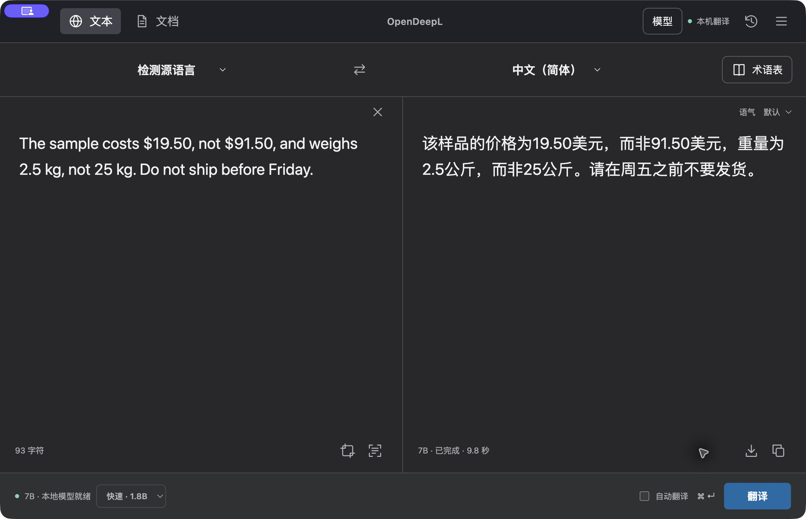

  

<h1 align="center">OpenDeepL</h1>

<strong>Copy twice. Translate locally. Keep your words on your device.</strong>

  <a href="LICENSE"><code>MIT code</code></a>
  <code>macOS + Windows</code>
  <code>Local inference</code>

<a href="README.zh-CN.md">简体中文</a> · <a href="docs/INSTALL.md">Install & build</a> · <a href="https://github.com/HHHHHarris/OpenDeepL-updates/releases/tag/v0.7.0">0.7.0 release</a> · <a href="docs/TRY.md">Try it & share feedback</a>

OpenDeepL is an independent, open-source desktop translator for macOS and Windows. Text, screenshots, and supported documents are translated on your computer after you set up the model and local runtime. No translation API key is required. It is **not affiliated with DeepL SE**.

> **0.7.0 self-contained community release.** Apple Silicon Mac and Windows x64 packages bundle the local runtime; model weights are a separate first-run download or verified import. Mac builds use a fixed local signature, **not** Apple Developer ID or notarization; Windows builds are unsigned. See [installation and first-open notes](docs/INSTALL.md) and [release notes](docs/RELEASE-0.7.0.md). Existing `.odup` assets are compatible-app runtime updates, not standalone installers.

### Download 0.7.0

[**Apple Silicon Mac · DMG**](https://github.com/HHHHHarris/OpenDeepL-updates/releases/download/v0.7.0/OpenDeepL-0.7.0-macos-arm64.dmg) · [**Windows x64 · installer**](https://github.com/HHHHHarris/OpenDeepL-updates/releases/download/v0.7.0/OpenDeepL-0.7.0-windows-x64-setup.exe) · [**SHA-256 checksums**](https://github.com/HHHHHarris/OpenDeepL-updates/releases/download/v0.7.0/SHA256SUMS-0.7.0.txt)

## See the real app

*Actual 0.7.0 App capture, using invented text—not a mockup. The current interface is primarily Simplified Chinese. [Model setup, idle unloading & demo details](docs/DEMO.md).*

## Quick start

1. Download the package for your platform from the [v0.7.0 release](https://github.com/HHHHHarris/OpenDeepL-updates/releases/tag/v0.7.0), and compare its SHA-256 with the checksum file. On Mac, copy the App from the DMG; on Windows, run the installer. First-open security warnings are possible because the packages lack public publisher signing/notarization.
2. Open OpenDeepL. The bundled runtime is checked automatically. Download the default 7B model, or choose an existing exact Q8 model file for SHA-256 verification; the optional 1.8B model provides fast mode.
3. Translate text in the App. See [INSTALL.md](docs/INSTALL.md) for permissions, document limitations, first-open guidance, and 0.6.x upgrade notes.

## Help shape the first release

Looking for the **first five independent testers**, not five-star reviews. Try one invented sentence and tell us where setup or translation gets in the way. A failed install is useful feedback too.

[**5-minute trial**](docs/TRY.md) · [**Share first-run feedback**](https://github.com/HHHHHarris/OpenDeepL-updates/issues/new?template=first-run-feedback.yml)

The checklist takes about five minutes **after model setup**; downloads and first model loading take extra time. Issues are public: use synthetic examples, not private text, documents, or raw logs.

## Why OpenDeepL?

- **Stay in your workflow:** double-copy selected text with `⌘C+C` on Mac or `Ctrl+C+C` on Windows.
- **Choose speed or depth:** a small 1.8B model for quick reading, with a 7B retranslate button when you want another pass.
- **Keep control of your data:** local inference, local OCR, and local document processing—no translation subscription or cloud API key.

## What you can do

| Workspace | Current behavior |
| --- | --- |
| Text | Translate with Hy-MT2-7B Q8 by default; choose the optional Hy-MT2-1.8B Q8 fast mode, then retranslate with 7B. A glossary guides output but is not a guaranteed term lock. |
| Capture | Select a screen region, run local OCR, and translate detected text. |
| Documents | Translate DOCX, PPTX, and supported text PDFs, one file or a batch of 1–20. The document path uses 7B. PDF support covers a conservative subset of common horizontal text; scans and complex layouts are rejected. |
| Desktop access | Tray actions, clipboard translation, double-copy capture, and context-menu/selection fallbacks where the operating system permits. Ordinary copy behavior remains available. Integration behavior and permissions differ by platform. |
| Local workspace | Review translation history and glossary entries stored on the device. History keeps up to 200 entries in local plaintext. |
| Runtime | One model is loaded at a time. Model weights unload after 60 seconds of idle time. |
| Updates | A compatible installed app can check a pinned maintainer feed for signed runtime updates. The startup check occurs after about 30 seconds and is optional in Settings. |

Fast mode is not quality-equivalent to 7B: the [real walkthrough](docs/DEMO.md) includes a missed negation and a 7B retranslation. Translation quality, OCR accuracy, fonts, and document layout vary. Review important output; document layout is not pixel-perfect. See [limitations and setup](docs/INSTALL.md).

## Build from source

1. Read [INSTALL.md](docs/INSTALL.md) for package status, model checksums, first-run notes, and platform-specific builds.
2. Clone this repository and run `npm ci` with Node.js 22.12+.
3. Prepare the pinned bundled runtime for your platform and obtain the exact model files described in the guide.
4. Run `npm start` for the developer shell or build a platform artifact. The source checkout does not contain runtime binaries or model weights.

## Privacy at a glance

Inference, OCR, document processing, glossary, and history are local after setup. The app does not send translation text or files to a cloud translation API. **Model downloads** (dependencies are bundled in 0.7) and the **optional GitHub update check** do use network access; the update request is for release metadata/packages, not document contents. See [PRIVACY.md](docs/PRIVACY.md) for storage and threat-model details.

## Open source, with distinct licenses

The original OpenDeepL code is MIT-licensed; see [LICENSE](LICENSE). Model weights, llama.cpp, Electron, Python packages, and other third-party components are governed by their own terms. The 0.7 runtime PDF stack uses pypdf, PDFium and ReportLab; their notices and the OFL font license are preserved separately. PyMuPDF is test-only, not bundled. See [THIRD_PARTY_NOTICES.md](THIRD_PARTY_NOTICES.md) and review the upstream licenses for anything you distribute.

## Project

- [Build and setup](docs/INSTALL.md) · [Development](docs/DEVELOPMENT.md) · [Privacy](docs/PRIVACY.md)
- [Roadmap](docs/ROADMAP.md) · [Changelog](CHANGELOG.md)
- [Contribute](CONTRIBUTING.md) · [Report a vulnerability](SECURITY.md)

The `HHHHHarris/OpenDeepL-updates` URL is retained because existing installed clients use it as their update feed. Its historical slug does not describe the scope of this newly published source repository. No user content, model weights, signing keys, or private development evidence belongs in issues or pull requests.
