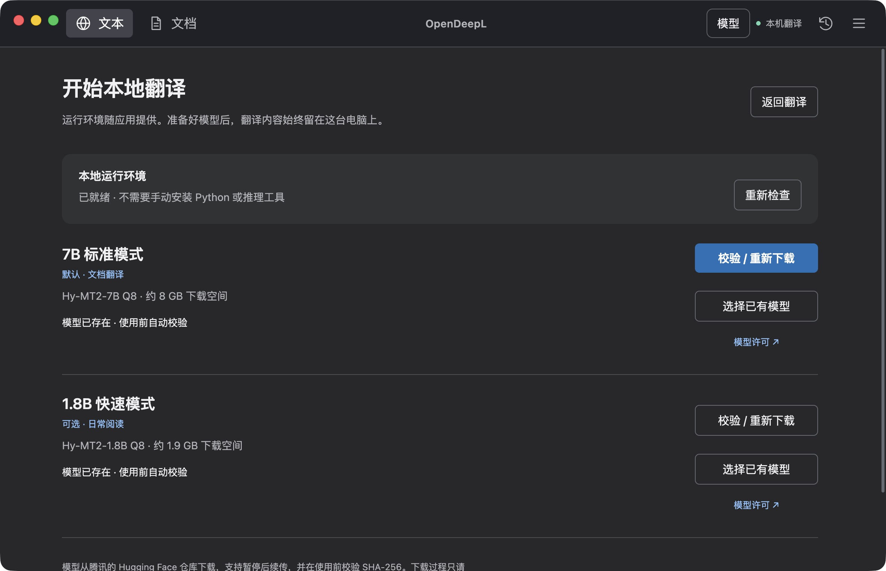
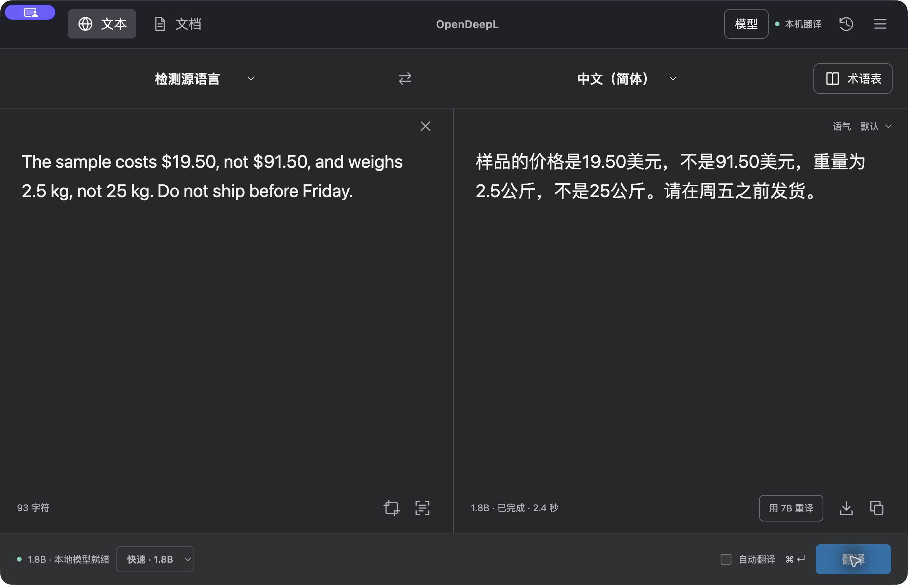
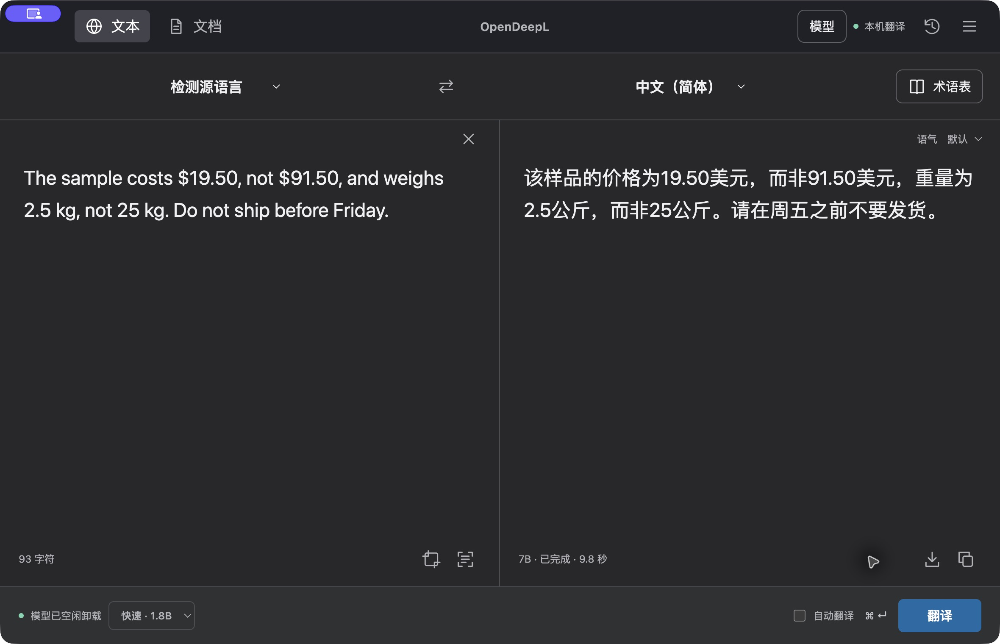

# OpenDeepL 0.7 — real App walkthrough / 真实 App 演示

[English README](../README.md) · [中文介绍](../README.zh-CN.md) · [Try it yourself](TRY.md) · [自己试用](TRY.zh-CN.md)

These are unedited window captures from the installed **0.7.0 macOS Apple Silicon App**, taken on **2026-10-30** with an isolated test profile and invented text. They are not design mockups, a speed benchmark, a recording of the Windows UI, or evidence of every supported workflow. The current interface is primarily Simplified Chinese.

以下是 2026-10-30 从已安装的 **0.7.0 Mac Apple Silicon App** 取得的原始窗口截图。使用独立测试数据及虚构文本，不包含用户文档或历史；不是效果图、速度评测或 Windows 界面录像，也不代表所有功能均已在这次演示中测试。当前界面主要为简体中文。

## 1. Prepare a model / 准备模型

The local runtime is bundled. This capture shows existing model files selected for use; a first-time user downloads the default 7B model (~8 GB), or imports and verifies the exact model file. 1.8B fast mode is optional (~1.9 GB). Download time is not included in the trial checklist.

运行环境随安装包提供。此图展示已选用本机现有模型文件的状态；首次使用可下载默认 7B（约 8 GB）或校验导入指定模型，1.8B 快速模式（约 1.9 GB）为可选项。试用清单的操作时间不包含模型下载。

## 2. Fast mode, then a 7B retranslation / 快速模式，再用 7B 重译

> The sample costs $19.50, not $91.50, and weighs 2.5 kg, not 25 kg. Do not ship before Friday.

**A real fast-mode miss:** in this run, 1.8B rendered “Do not ship before Friday” as “请在周五之前发货”, losing the negation. Amounts and units were retained, but the shipping instruction was reversed. This is why fast mode is for initial reading, not a quality-equivalent substitute. The screenshot is retained rather than editing the result or hiding the error.

**一次真实的快速模式误译：** 本次 1.8B 将“Do not ship before Friday”译为“请在周五之前发货”，漏掉否定，发货指令含义相反。金额和单位虽然保留了，重要内容仍需复核。这里保留原始结果，没有修改译文或隐藏失误。

Selecting **用 7B 重译** produced the following local 7B response, retaining the negation in this example. That is not a guarantee that 7B is always correct. Check amounts, decimal points, units, and negation; output wording can vary. The timing displayed is one observed run on one machine, not a general performance claim.

点击 **用 7B 重译** 后，以下本地 7B 输出在这个样本中保留了否定含义；这不代表 7B 始终正确。可核对金额、小数点、单位与否定含义；译文措辞可能变化。界面耗时只代表这一台机器上的单次运行，不是通用速度承诺。

The mode selector retains the preference for the next translation; the **7B** label below the result identifies this retranslation. 模式选择器保留下一次翻译的偏好；译文下方 **7B** 标签表示这次重译使用的模型。

## 3. Leave it idle / 空闲后卸载

After the 7B retranslation, the App was left idle for more than 60 seconds. The status changed to model sleeping; the completed translation remains visible. This is unloading model weights, not closing the App or deleting the model download.

7B 重译完成后闲置超过 60 秒，状态转为模型休眠，完成的译文仍保留在界面。卸载的是运行中的模型权重，不是退出 App 或删除已下载模型。

## Try your own workflow / 按自己的流程试用

- [English five-minute checklist](TRY.md) / [中文五分钟清单](TRY.zh-CN.md)
- [Installation, first-open warnings and document limitations](INSTALL.md)
- [0.7 release acceptance and its boundaries](RELEASE-0.7.0.md)
- [First-run feedback form](https://github.com/HHHHHarris/OpenDeepL-updates/issues/new?template=first-run-feedback.yml)

Text, OCR and document processing are local after setup. Model downloads and optional GitHub update checks use the network. The Mac build has no Apple Developer ID/notarization and Windows is unsigned; device policies may prevent first-open. Translation quality and document layout should be reviewed for important work. Do not post private content in public feedback.

完成配置后，翻译、OCR 与文档在本地处理；模型下载及可选的 GitHub 更新检查仍需联网。Mac 缺少 Apple Developer ID 签名/公证，Windows 未签名，设备策略可能阻止首次打开。重要用途应核对译文和文档版式。请勿在公开反馈中提交私人内容。
