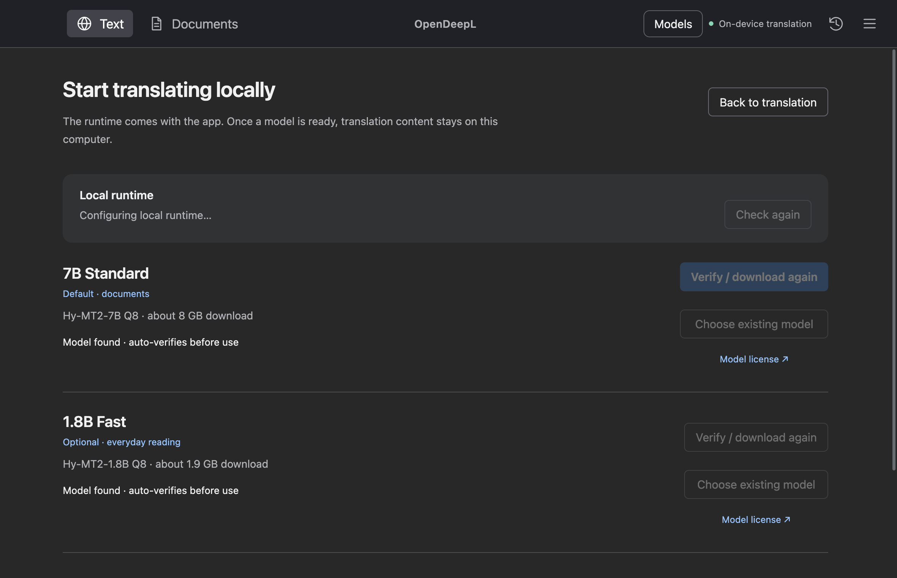
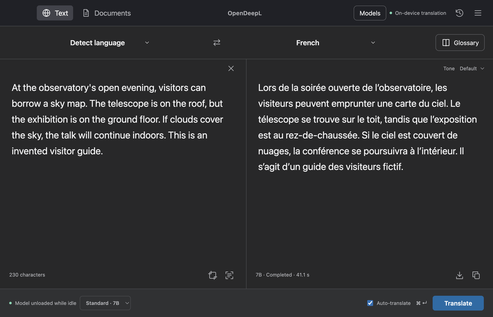
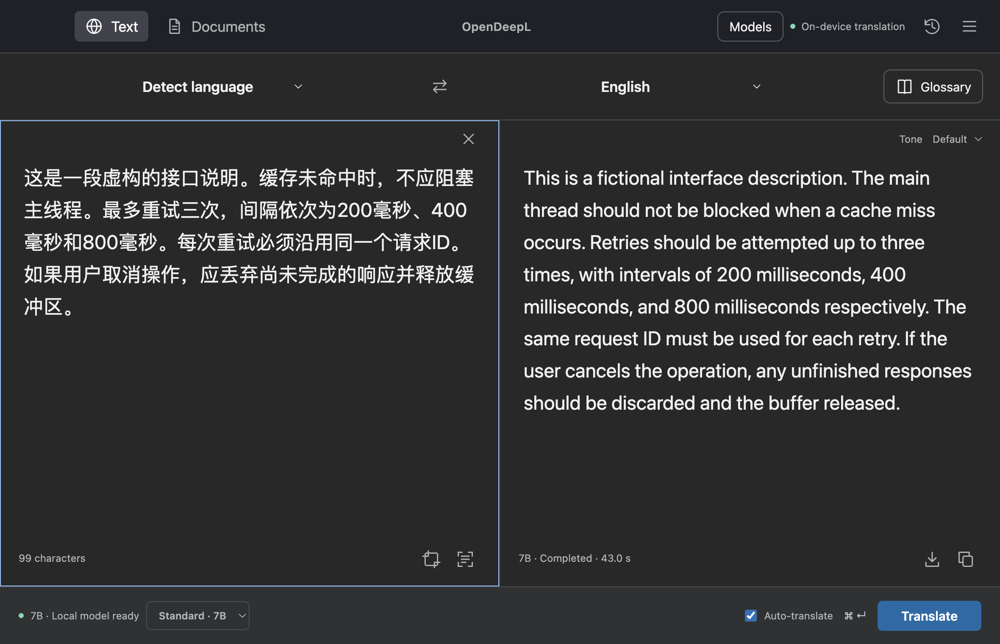
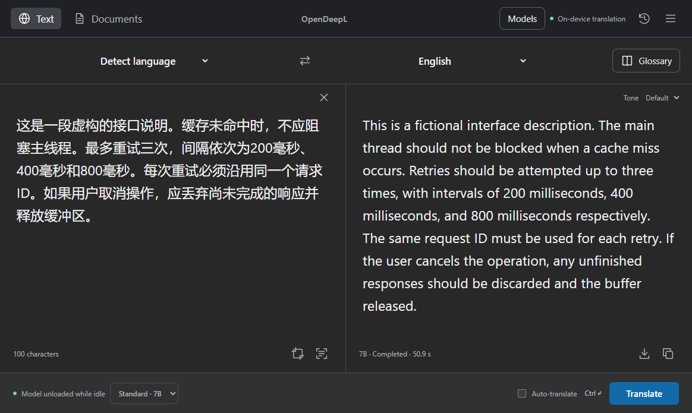
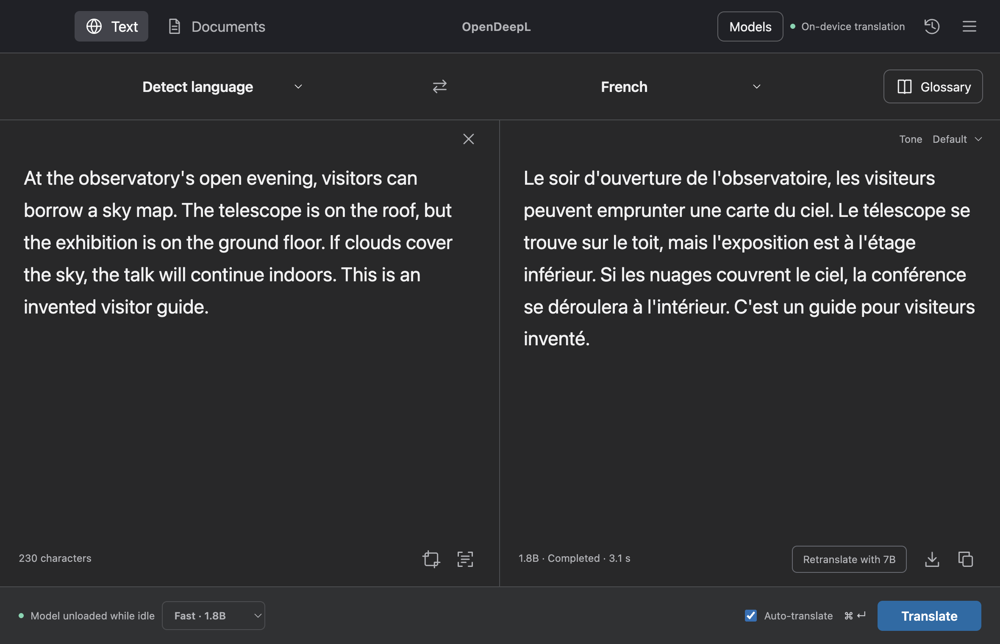

# OpenDeepL 0.7.1 — real-app walkthrough / 真实 App 演示

[English README](../README.md) · [中文介绍](../README.zh-CN.md) · [Try it](TRY.md) · [自己试用](TRY.zh-CN.md)

**OpenDeepL 0.7.1.** These are direct app-content captures with an English interface and invented source text—not mockups, edited translations, speed benchmarks, or proof of every workflow. The Mac observatory and fast-mode captures and the Windows capture come from final packages. The Mac technical capture is from an earlier genuine 0.7.1 candidate run. Content captures omit OS-controlled prompts; app-owned screenshot overlays follow the selected language. [Download the release](https://github.com/HHHHHarris/OpenDeepL-updates/releases/tag/v0.7.1).

**OpenDeepL 0.7.1。** 以下是英文界面 App 的直接内容截图，原文完全虚构；不是效果图、修改过的译文、速度基准或全功能验收证明。Mac 天文台与快速模式图、Windows 图来自最终安装包；Mac 技术说明图来自较早的真实 0.7.1 候选构建。内容截图不包含操作系统控制的提示；App 自有截图覆盖层遵循所选语言。[下载已发布版本](https://github.com/HHHHHarris/OpenDeepL-updates/releases/tag/v0.7.1)。

## 1. Choose a model / 准备模型

The runtime is bundled with the full installer; model weights are separate. The default 7B Q8 is about 8 GB; optional 1.8B Q8 fast mode is about 1.9 GB. You can download them or verify/import the exact existing files. Model download and first loading are outside the short trial time.

完整安装包附带运行环境，模型权重需另行准备。默认 7B Q8 约 8 GB，可选 1.8B Q8 快速模式约 1.9 GB；可下载，也可校验导入完全相同的已有文件。模型下载及首次加载不计入简短试用时间。

## 2. Translate an invented observatory guide / 翻译虚构天文台导览

**English source (auto-detected) → French, default 7B**

> At the observatory's open evening, visitors can borrow a sky map. The telescope is on the roof, but the exhibition is on the ground floor. If clouds cover the sky, the talk will continue indoors. This is an invented visitor guide.

In this observed 7B run, the French output keeps the telescope **sur le toit**, the exhibition **au rez-de-chaussée**, and the cloudy-day talk **à l’intérieur**. This is actual one-run output, not an edited ideal translation; other runs may differ.

本次观察到的 7B 法语输出分别保留望远镜在**屋顶**（sur le toit）、展览在**底层**（au rez-de-chaussée）、阴天讲座在**室内**（à l’intérieur）。这是未经改写的单次实际输出，其他运行可能不同。

## 3. A technical instruction / 虚构技术说明

**Chinese source (auto-detected) → English, default 7B**

> 这是一段虚构的接口说明。缓存未命中时，不应阻塞主线程。最多重试三次，间隔依次为200毫秒、400毫秒和800毫秒。每次重试必须沿用同一个请求ID。如果用户取消操作，应丢弃尚未完成的响应并释放缓冲区。

In this observed 7B run, the English output says the main thread **should not be blocked**, retains **up to three** retries at **200/400/800 ms**, the **same request ID**, and discarding unfinished responses and releasing the buffer on cancellation. It is one observed result, not a correctness guarantee. Earlier synthetic testing caught a missed negation in 1.8B; 7B is not infallible either.

本次观察到的 7B 英文输出保留了**不阻塞**主线程、最多**三次**重试及 **200/400/800 毫秒**间隔、沿用**同一请求 ID**、取消后丢弃未完成响应并释放缓冲区。截图是一次实际结果，不保证总能正确。以往合成测试发现 1.8B 漏过否定；7B 同样不能保证无误。

### The installed Windows app / 已安装的 Windows App

The final unsigned Windows installer was installed in an isolated directory. In its real GUI, English selection persisted across a restart; the app-owned model-chooser title appeared in English, while Windows-owned chooser controls followed the OS language. A 7B run of the same invented technical note retained the negation, retry intervals, request ID and cancellation instructions. The screenshot below shows a **later** 7B run of that note in the same installed package, with **50.9 s** displayed. The separate first 7B acceptance run took **112.7 s**. These are individual observations, not comparable performance figures.

最终未签名的 Windows 安装程序已独立安装到隔离目录。真实 GUI 中英文选择在重启后保留；App 自有模型选择器标题为英文，Windows 自有按钮仍随系统语言。同一虚构技术说明的 7B 译文保留了否定、重试间隔、请求 ID 和取消指令。下图是同一最终包**稍后的** 7B 运行，界面显示 **50.9 秒**；首次 7B 验收运行是 **112.7 秒**。两次只是单独观察，不是可比较的性能数据。

## 4. Fast mode and idle state / 快速模式与空闲状态

Fast mode uses the optional 1.8B model for an initial reading and offers **Retranslate with 7B**. In this observed run, 1.8B rendered “ground floor” as **à l'étage inférieur** (“lower floor”), which is less precise than the 7B result **au rez-de-chaussée**. This illustrates a real difference, not a general model ranking. Compare actual outputs before relying on negation, numbers or instructions. The main screenshot above was captured after idle unloading, with the completed translation still visible. A local API check after 60 seconds showed 7B sleeping and 1.8B unloaded. These are one-machine observations, not a speed benchmark.

快速模式用可选 1.8B 模型初读，并提供**用 7B 重译**。本次 1.8B 把“ground floor”译为 **à l'étage inférieur**（较笼统的“下层”），没有 7B 的 **au rez-de-chaussée**（底层／一层）精确。这是一次真实差异，不代表模型总体排名。尤其要核对否定、数字与指令。上方主图拍摄于空闲卸载后，完成的译文仍可显示。空闲 60 秒后的本地 API 检查显示 7B 休眠、1.8B 已卸载；这些只是单台机器的观察，不是速度基准。

## Try it / 自己试用

[English checklist](TRY.md) · [中文清单](TRY.zh-CN.md) · [Installation and first-open notes](INSTALL.md) · [0.7.1 release notes](RELEASE-0.7.1.md)

Text, OCR and supported document processing are local after setup. Model downloads and optional GitHub update checks use the network. The Mac package has no Developer ID/notarization and Windows is unsigned; device policy may block them. Review important output and keep public feedback synthetic.
